<div align="center">

# ✈️ CI-Plane

**Ephemeral, self-hosted GitHub Actions runners on your own Linux servers.**<br>
One container with a web interface. Every job gets a fresh runner and its own Docker daemon, and leaves nothing behind.


[](https://github.com/saschazesiger/CI-Plane/pkgs/container/ci-plane)
[](https://github.com/saschazesiger/CI-Plane/actions/workflows/ci.yml)

[⚡ Quick start](#-quick-start) ·
[👀 See it](#-see-it) ·
[🧭 How it works](#-how-it-works) ·
[🔒 Security](#-security) ·
[📚 Docs](#-documentation)

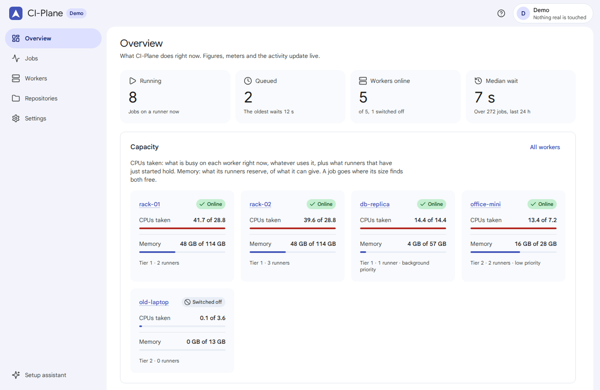

</div>

> **Status: first release, 0.1.0.** The flows against GitHub and Cloudflare are covered by tests against simulated
> APIs, and the runner start and cleanup by opt-in tests against a real Docker daemon. A complete end-to-end run
> against real GitHub and Cloudflare accounts is still to be confirmed. Please report what you find.

## ✨ Why CI-Plane?

| | |
|---|---|
| 🧽 **Ephemeral runners** | One runner per job, registered just in time for that one job, removed with its containers and volumes afterwards. |
| 🐳 **A Docker daemon per job** | Images, containers and networks of a job live in its own daemon and go with it. `docker build` and service containers just work. |
| ⚖️ **Placed by real load** | A job goes to the worker that is least busy right now, and to none that is busy, whether with jobs or with other work. No CPU limits: a job uses every CPU that is free. |
| 🎚️ **CPU priority per worker** | Add servers that are in use for other things: in the background, jobs only get the CPU nothing else wants. |
| 🪜 **Tiers** | Fill your own hardware first; use the expensive machine only when tier 1 is full. |
| 🛟 **Survives what goes wrong** | Lost webhooks, restarts in the middle of a step, dead servers: every step is stored before it runs and compared with GitHub every minute. |
| 🧙 **Set up from the browser** | A five-step assistant creates the GitHub App, the Cloudflare tunnel and the login, and connects your first server. |
| 🔑 **No agent on workers** | A worker needs Docker and an SSH login. CI-Plane runs plain `docker` commands over SSH. |
| 📦 **One container, one file** | One Go binary with the interface built in, `cloudflared` bundled, all state in one SQLite file under `/data`. |

## ⚡ Quick start

**1. Start CI-Plane** on any Linux machine with Docker (x86_64):

```sh
docker run -d --name ci-plane --restart unless-stopped \
  -p 8080:8080 -v ci-plane:/data ghcr.io/saschazesiger/ci-plane:latest
```

or with Compose, using the [docker-compose.yml](docker-compose.yml) of this repository: `docker compose up -d`.

**2. Open `http://<address of the machine>:8080` right away.** The first visitor sets the admin password, so do it
before anyone else can reach the port.

**3. Follow the assistant.** Five steps, each checked live:

| | Step | What you do |
|---|---|---|
| 1 | 🔐 Password | Choose the admin password for the local address. |
| 2 | ☁️ Cloudflare | Create an API token with one click, paste it, pick a subdomain and who may sign in. CI-Plane creates the tunnel, the DNS record and Cloudflare Access. |
| 3 | 🐙 GitHub | Choose your account or an organisation. GitHub opens; click **Create GitHub App**, then **Install** on the repositories. |
| 4 | 🖥️ First worker | Paste one command on a server as root, enter its address. CI-Plane connects, pulls the images and turns green. |
| 5 | 🚀 Try it | Push a workflow with the `runs-on` line below. The job shows up live. |

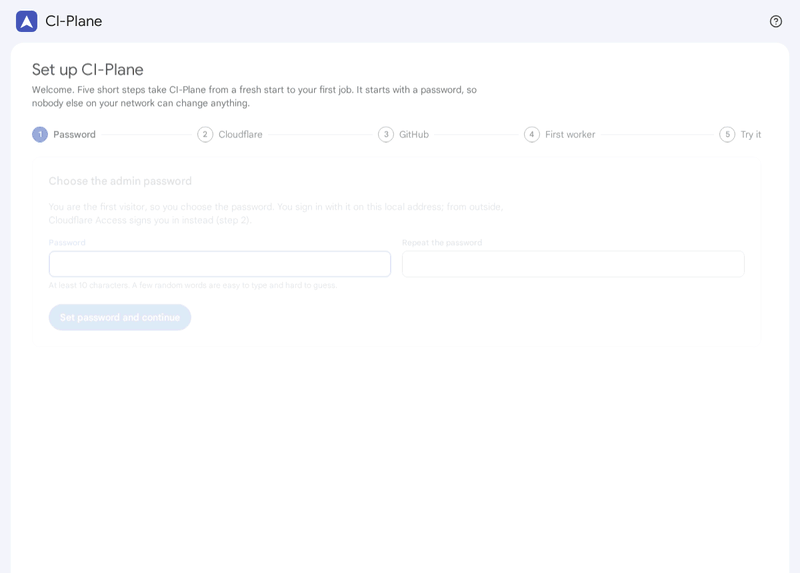

**4. Use it in a workflow:**

```yaml
jobs:
  build:
    runs-on: [self-hosted, ci-plane, size-m]
    steps:
      - uses: actions/checkout@v5
      - run: make test
```

| Label | Free CPUs to start | Memory | |
|---|---|---|---|
| `size-s` | 2 | 4 GB | |
| `size-m` | 4 | 8 GB | default when no size is given |
| `size-l` | 8 | 16 GB | |
| `size-xl` | 16 | 32 GB | |

Sizes are editable in the settings. Jobs without the label `ci-plane` stay on GitHub's own runners.
The [quick start guide](docs/quick-start.md) walks through every click.

## 👀 See it

**Live jobs.** Tiles, capacity meters and the job list update as GitHub queues, starts and finishes jobs.

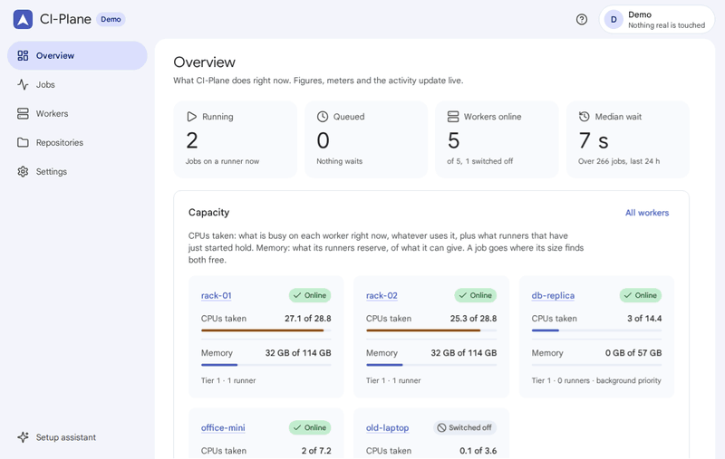

<table>
<tr>
<td width="50%">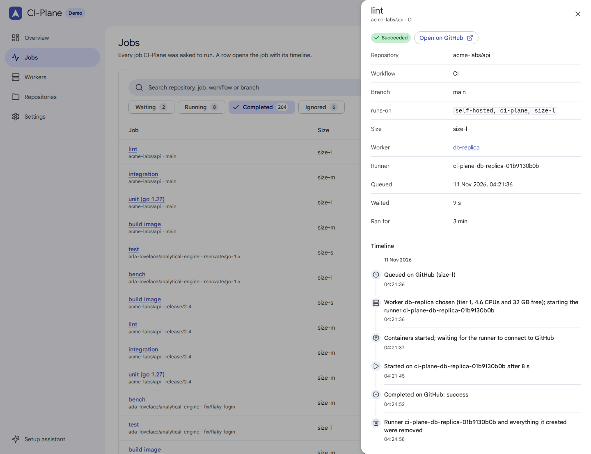<br>🧾 <b>A timeline per job</b>: why it waited, which worker was chosen, every attempt, the cleanup.</td>
<td width="50%">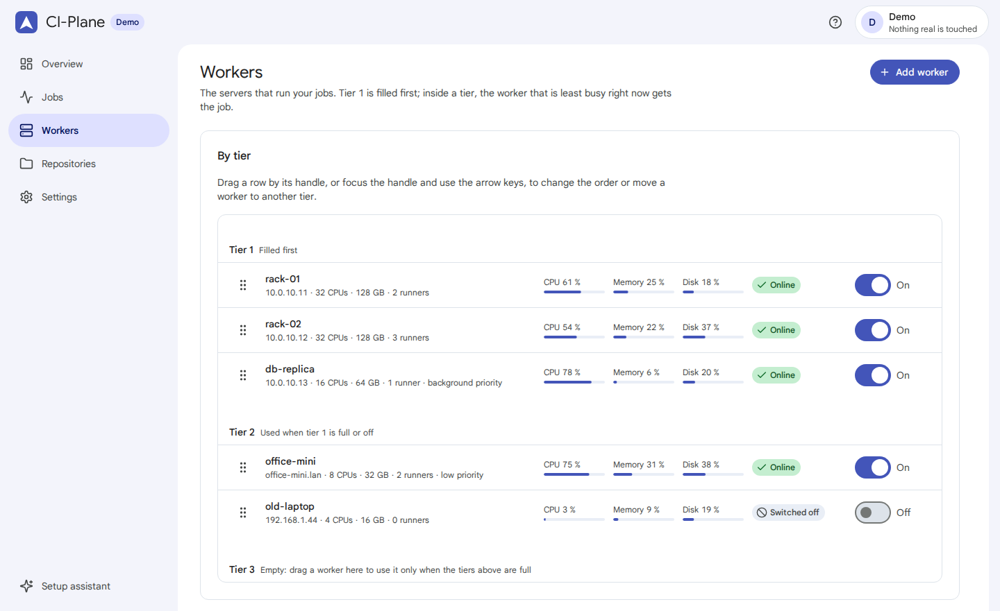<br>🪜 <b>Workers by tier</b>: drag to reorder, switch off, drain, live meters.</td>
</tr>
<tr>
<td>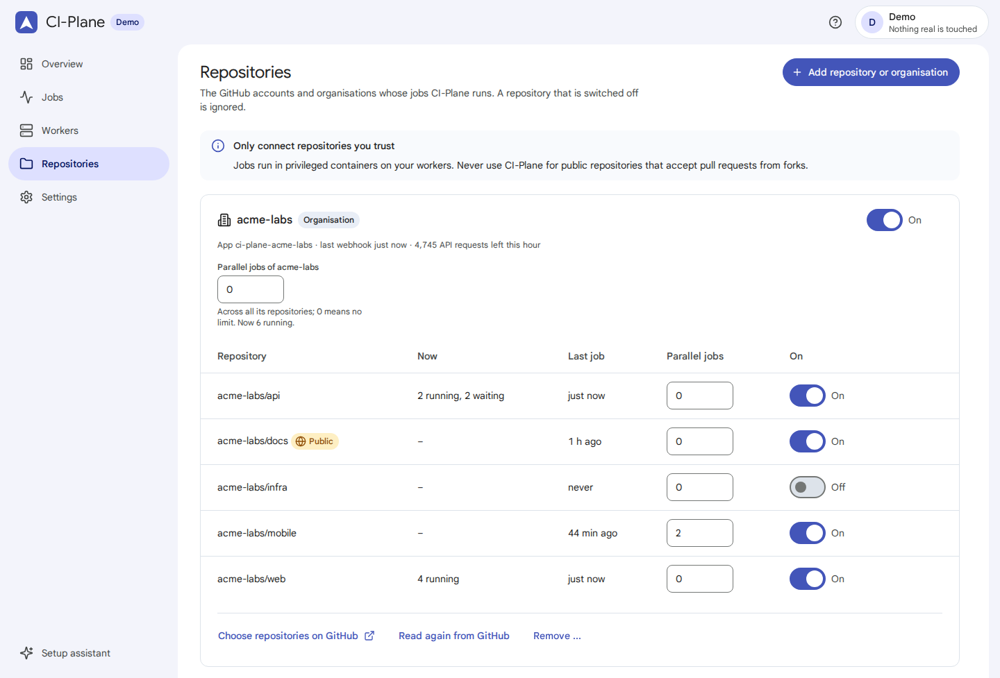<br>📦 <b>Repositories</b>: switch each on or off, limit parallel jobs per repository or account.</td>
<td>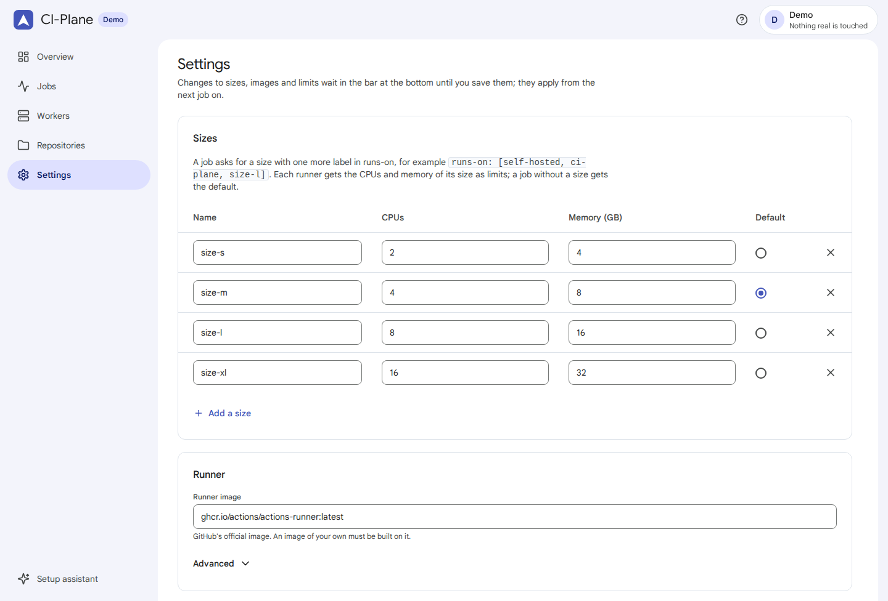<br>🔧 <b>Settings</b>: sizes, runner image, timeouts, the tunnel and the password.</td>
</tr>
</table>

📱 **Phones and dark mode included.**

<p>
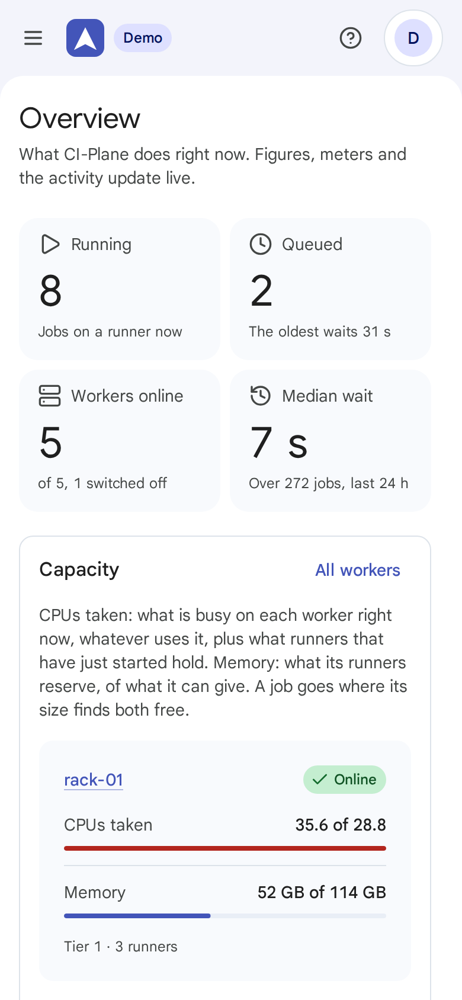
&nbsp;&nbsp;
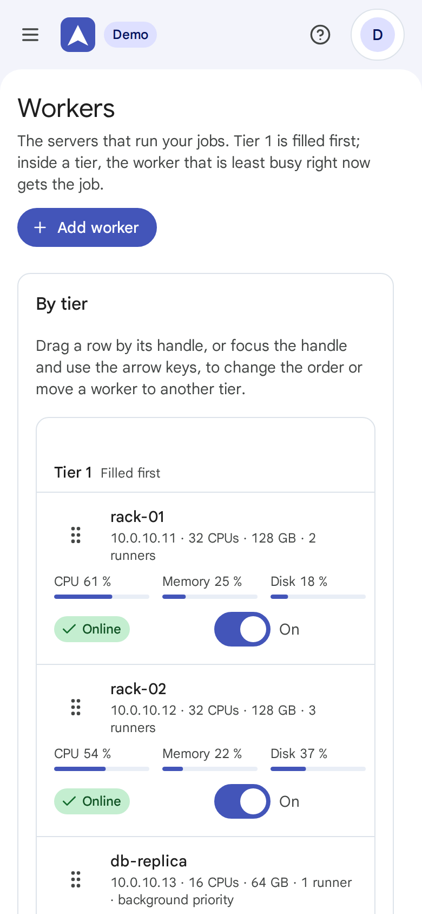
&nbsp;&nbsp;
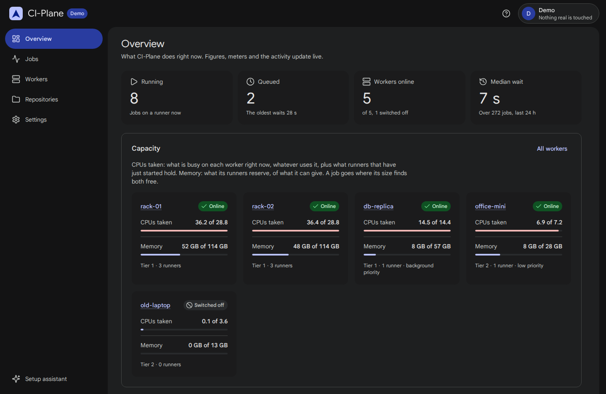
</p>

Want to click around without servers? `CI_PLANE_DEMO=1` runs the interface on simulated GitHub, Cloudflare and
workers (see [Development](docs/development.md#-demo-mode)).

## 🧭 How it works

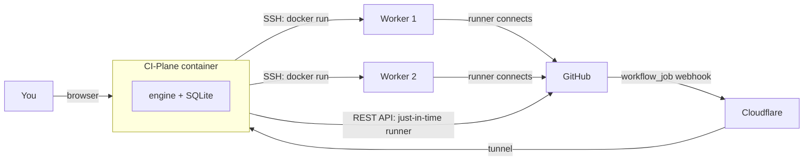

GitHub sends a `workflow_job` webhook through a Cloudflare tunnel, so CI-Plane needs no open port. CI-Plane matches the
labels, picks the worker that has the CPUs of the size free and is least busy, reserves the memory there and registers a just-in-time runner that is valid
for one job. Over SSH it starts two containers on that worker: a Docker daemon for this job and the runner. When the
job is over, both containers and their volumes are removed. Every step is written to SQLite before it is carried out,
and a check against GitHub every minute catches anything a webhook missed.
More in [How it works](docs/how-it-works.md).

## 📋 Requirements

| | |
|---|---|
| 🖥️ **CI-Plane** | Any x86_64 Linux machine with Docker. It needs outgoing access to GitHub, to the Cloudflare API, to Cloudflare's tunnel edge (port 7844) and to the workers' SSH ports. |
| 🧱 **Workers** | Linux on x86_64, reachable over SSH from CI-Plane (LAN, VPN or internet), with internet access to pull images, and root once to paste the setup command (it installs Docker if missing). Made for Ubuntu and Debian; an opt-in test covers Ubuntu 24.04 and Debian 13. |
| ☁️ **Cloudflare** | An account with a domain on Cloudflare DNS, and Zero Trust enabled (the free plan is enough). |
| 🐙 **GitHub** | A personal account or an organisation you own. |

**Not supported:** arm64 workers, Windows or macOS jobs, reaching CI-Plane from the internet without Cloudflare, and
untrusted code (see below).

## 🔒 Security

CI-Plane is built for **repositories you trust**. Each job gets a privileged Docker-in-Docker container, and access
to a privileged container or to Docker on the worker equals root on that worker. A job can therefore take over the
worker it runs on and read anything on it. **Never connect public repositories that accept pull requests from forks**,
and do not put workers next to data the jobs must not see. The admin password protects the local address; from the
internet only the e-mail addresses you name get in, through Cloudflare Access, and `/webhook` only accepts events signed
by your GitHub App. Details, the key file and hardening tips: [Security](docs/security.md). To report a vulnerability,
see [SECURITY.md](SECURITY.md).

## 📚 Documentation

| | |
|---|---|
| ⚡ [Quick start](docs/quick-start.md) | From `docker run` to the first green job, click by click |
| 🧭 [How it works](docs/how-it-works.md) | Architecture, the life of a job, scheduling, what runs on a worker |
| 🖥️ [Workers](docs/workers.md) | Requirements, the setup command, tiers, drain, clean up, removal |
| 🐙 [GitHub](docs/github.md) | The app and its permissions, labels and sizes, `ubuntu-latest` differences, your own runner image |
| 🛫 [Failover to GitHub](docs/failover.md) | GitHub-hosted runners when your workers are full: setup, costs, switching off |
| ☁️ [Cloudflare](docs/cloudflare.md) | The token, what is created, Access, repair and removal |
| 🛟 [Reliability](docs/reliability.md) | Every failure and what CI-Plane does about it |
| 🔒 [Security](docs/security.md) | Trust model, the two listeners, secrets, privileged containers |
| 🔧 [Configuration](docs/configuration.md) | Environment variables, settings, backup, updates |
| 🩺 [Troubleshooting](docs/troubleshooting.md) | Symptoms, causes and fixes |
| 🛠️ [Development](docs/development.md) | Layout, build, tests, demo mode, screenshots |

## 🛠️ Develop

```sh
go build ./... && go vet ./...
go test ./...                                    # about half a minute
CI_PLANE_DEMO=1 go run ./cmd/ci-plane            # the interface on simulated workers, http://localhost:8080
```

The demo mode runs the real engine against a simulator and touches nothing real. Rules for changes are in
[AGENTS.md](AGENTS.md) and [CONTRIBUTING.md](CONTRIBUTING.md); everything else in [Development](docs/development.md).
Changes are listed in the [changelog](CHANGELOG.md).

## 📄 Licence and credits

MIT, see [LICENSE](LICENSE). CI-Plane stands on:

- [Z-Dash](https://github.com/saschazesiger/Z-Dash) for the whole interface (MIT, vendored).
- [cloudflared](https://github.com/cloudflare/cloudflared) for the tunnel (Apache 2.0, bundled in the image).
- The official runner image [ghcr.io/actions/actions-runner](https://github.com/actions/runner) (MIT), and
  `docker:dind` and `registry:2` from Docker Hub, pulled on the workers.
