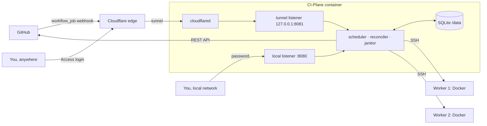
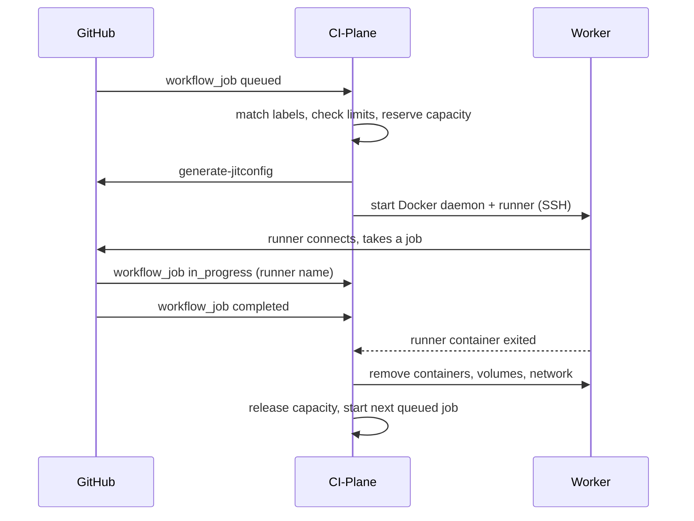

# 🗺️ CI-Plane: project plan

> Status: **draft for approval**. Nothing is implemented yet. After approval this document becomes the basis of
> `docs/how-it-works.md` and is removed.

CI-Plane is a single container with a web interface that starts **ephemeral, self-hosted GitHub Actions runners** on
your own Linux servers. A job is queued on GitHub, CI-Plane picks the worker with the most free capacity, starts a
runner there over SSH, and removes every trace of it when the job is done.

## 1. Decisions

| Topic | Decision |
|---|---|
| Language | **Go**, one static binary, web assets embedded |
| Storage | **SQLite** (WAL) in one volume, `/data` |
| GitHub | **GitHub App**, created from the UI with the manifest flow |
| Public access | **Cloudflare Tunnel only**, `cloudflared` bundled and supervised, set up from the UI with an API token |
| Web UI access | Local address with the **admin password**; through the tunnel **Cloudflare Access is the login** (SSO) |
| First start | No setup code: the first visitor of the local address sets the password |
| Workers | Any host reachable by SSH (LAN, VPN, public IP); CI-Plane knows nothing about Tailscale |
| Worker login | Dedicated user `ci-plane` (group `docker`), created by a one-line command |
| Isolation | **One Docker daemon per job** (DinD); only trusted repositories |
| Capacity | **Reservation** by size label, enforced as container limits, plus **live measurement** as a guard |
| Priority | **Tiers**: fill the highest tier first, inside a tier the worker with the most free capacity |
| Kept between jobs | Pre-pulled runner image, a registry mirror per worker |
| Runner image | Official `ghcr.io/actions/actions-runner`, changeable in the settings |
| Architecture | `linux/amd64` workers |
| Extras in v1 | Event timeline per job, drain, limits per repository/organisation, Docker installed by the setup command |
| Not in v1 | Prometheus metrics, notifications, pinning repositories to workers, arm64, other ingress than Cloudflare |
| Design | **Only** [Dashboard-Style](https://github.com/saschazesiger/Dashboard-Style), vendored, no framework, no bundler |
| Licence | MIT |

### Points where the plan differs from what we discussed

1. **Registry mirror covers Docker Hub only.** Docker's mirror setting does not apply to other registries such as
   GHCR. Docker Hub is where rate limits and repeated pulls hurt; other registries are pulled directly.
2. **One GitHub App per account or organisation.** A private app can only be installed on the account that owns it.
   "Add organisation" therefore creates an app inside that organisation (still one click) and then installs it.
   Making one app public would let strangers install it, so that is not offered.
3. **CPU and memory limits are per container, not per job.** A job is two containers (runner and its Docker daemon);
   each gets the full size as its limit. Steps run in one or the other, so real use rarely exceeds the size, but the
   worst case for memory is twice the size. The scheduler keeps a headroom per worker and checks the memory that is
   really available before placing a job. One shared limit for both containers needs root on the worker and is on the
   roadmap.
4. **A slow GitHub check stays, although polling is not an ingress mode.** Every minute CI-Plane compares its state
   with GitHub and asks GitHub to redeliver failed webhooks. This is the safety net behind "extremely durable", not a
   way to run without a tunnel.

## 2. Architecture



Two listeners make the origin of a request unambiguous:

| Listener | Reachable from | Serves | Login |
|---|---|---|---|
| `:8080` (published) | local network | UI, API, first-run setup | admin password |
| `127.0.0.1:8081` | `cloudflared` in the same container only | `/webhook`: signed GitHub events. Everything else: UI and API | valid Cloudflare Access token with an allowed e-mail; the setup pages are never served here |

### Life of a job



GitHub does not bind a runner to a job: it gives a queued job to **any** idle runner whose labels fit. CI-Plane
therefore tracks **demand** (jobs) and **supply** (runners) separately and only learns which runner took which job
from the `in_progress` event. Consequences built into the design:

- A runner carries exactly the labels of the job it was started for, so it can only take a job of the same size.
- If a runner is taken by a different job, the reconciler sees a queued job without a runner and starts one.
- A runner that stays idle for 10 minutes, or whose demand disappeared (job cancelled), is removed.

### States

| Object | States |
|---|---|
| Job | `queued` → `assigned` → `running` → `completed`; `ignored` (labels do not match, with the reason shown) |
| Runner | `provisioning` → `starting` → `idle` → `busy` → `cleaning` → `removed`; `failed` |
| Worker | `setup` → `online`; `disabled` (switch), `draining`, `unreachable`, `unhealthy` (circuit breaker), `disk-full` |

Every transition is written to SQLite **before** the action it describes (intent first). Names are deterministic
(`ci-plane-<worker>-<id>`) and every Docker object carries the label `ci-plane.runner=<id>`, so after a crash the
manager can find what it started and finish or undo it.

## 3. Scheduling

**Labels.** A job is handled when its `runs-on` contains `ci-plane` and every label is known:
`self-hosted`, `linux`, `x64`, `ci-plane` and at most one size.

```yaml
runs-on: [self-hosted, ci-plane, size-m]
```

| Size | CPU | Memory | |
|---|---|---|---|
| `size-s` | 2 | 4 GB | |
| `size-m` | 4 | 8 GB | default without a size label |
| `size-l` | 8 | 16 GB | |
| `size-xl` | 16 | 32 GB | |

Sizes and the default are editable in the settings.

**Capacity of a worker.** Allocatable = detected CPU and memory minus a reserve for the system (default 10 % and
1 GB). Free = allocatable minus the reservations of its runners.

**A worker is eligible when** it is enabled, online and not draining, has room for the size, has enough free disk
(default 15 GB), really has the memory available right now (live value), and its circuit breaker is closed.

**Choice.** Lowest tier number first; inside the tier the worker with the largest free share
(`min(free CPU share, free memory share)`).

**Queue.** When nothing fits, the job waits. Order is first come, first served, with limits per repository and
organisation. A small job may overtake a large one that does not fit yet; once a job has waited five minutes,
nothing overtakes it on a worker that could hold it (no starvation).

**Live values.** One long-running command per worker streams load, available memory and free disk every five
seconds over the open SSH connection. A missing stream marks the worker `unreachable` within 15 seconds.

## 4. Runner on a worker

All actions are plain `docker` commands over SSH; nothing is installed on the worker except Docker.

Per job:

| Object | Purpose |
|---|---|
| container `…-dind` | `docker:dind`, privileged, size limits, uses the worker's registry mirror |
| container `…-runner` | runner image, unprivileged, shares the network of `…-dind` (so `localhost` service ports work), `run.sh --jitconfig …` |
| volumes | work directory, runner externals, Docker socket, Docker data; shared between both at the same paths, as container jobs need |

Cleanup removes both containers and everything labelled with the runner id. Because all images, containers,
networks and volumes a job creates live inside its own Docker daemon, nothing is left on the worker.

Per worker, kept between jobs: the runner image (refreshed daily) and the mirror `ci-plane-mirror`
(`registry:2` as a pull-through cache with a size cap).

The end of a job is detected three ways: the `completed` webhook, the exit of the runner container (Docker event
stream), and the periodic comparison. Any one of them is enough.

## 5. Durability

| Failure | What happens |
|---|---|
| Webhook lost or manager down | Every minute: list queued jobs of active repositories, ask GitHub to redeliver failed deliveries. Duplicate events are harmless (job id is the key). |
| Manager restart or crash | State is in SQLite. On start: adopt running containers, finish half-done starts and cleanups, remove what is unknown. |
| Start fails on a worker | Remove the half-started objects and the runner registration, put the job back in the queue, try another worker first. Backoff from 5 s to 5 min, retried as long as GitHub still shows the job as queued. |
| Worker repeatedly fails | After three failures in a row: `unhealthy`, no new jobs. Probed every 30 s and taken back automatically. |
| Worker unreachable | Jobs waiting for it are moved to other workers at once. Runners on it are checked against GitHub; lost ones are deregistered, their capacity released, and cleaned up when the worker returns. |
| Runner never connects | Two minutes after start: remove and retry. |
| Runner idle or job cancelled | Removed after the idle time. |
| Job hangs | Hard limit (default 6 h, like GitHub-hosted runners), then the runner is removed. |
| Disk fills up | Janitor (below); under the threshold the worker is `disk-full` until space is back. |
| Runner registered but gone | Offline `ci-plane-*` runners unknown to the database are deleted on GitHub. |
| `cloudflared` dies | Restarted with backoff, status shown in the UI. |
| Tokens | Installation tokens are renewed before they expire; API calls retry with backoff and respect rate limits. |

**Janitor**, every 10 minutes and after each job, per worker. It only touches objects labelled `ci-plane.*`, never
anything else on the host:

- containers, volumes and networks of runners that no longer exist
- old versions of the runner image and dangling images
- the mirror, emptied when it exceeds its cap (default 20 GB)
- an urgent pass when free disk falls under the threshold

## 6. Setup and security

**Start**

```sh
docker run -d --name ci-plane -p 8080:8080 -v ci-plane:/data ghcr.io/saschazesiger/ci-plane
```

Then open `http://<ip>:8080`. The assistant checks every step live and shows a green tick:

1. **Password**: set the admin password.
2. **Cloudflare**: a link opens Cloudflare's "create token" page with the permissions filled in. Paste the token,
   pick the domain and a subdomain, enter the e-mail addresses that may sign in. CI-Plane creates the tunnel, the DNS
   record, the routing and two Access applications (whole host: allowed e-mails; `/webhook`: bypass), starts
   `cloudflared` and verifies from outside that `/` asks for a login and `/webhook` answers.
3. **GitHub**: choose "personal account" or "organisation", one click creates the app, a second installs it on the
   chosen repositories.
4. **Worker**: enter the address, copy the command, paste it on the server as root. The page waits and turns green
   when the worker answers.
5. **Try it**: a ready `runs-on` line to copy, and a live view that shows the first job arriving.

The same assistants are behind "Add repository or organisation" and "Add worker" later.

**Worker command.** One self-contained line that contains the manager's public key and downloads nothing from the
manager: installs Docker when it is missing, creates the user `ci-plane` in the group `docker`, authorises the key.
After that the manager does the rest itself: detects CPU, memory and disk, pulls the runner image, starts the mirror,
runs a test container. The host key is stored at first contact and checked afterwards. The assistant also shows the
command that removes everything again.

**Security**

- Secrets (app private key, webhook secret, Cloudflare token, SSH private key) are encrypted at rest with a key from
  `/data` or `CI_PLANE_SECRET_KEY`.
- Webhooks: signature checked with the secret of the app that sent them.
- Tunnel: every request except `/webhook` needs a valid Access token (signature, audience, allowed e-mail), checked
  by CI-Plane itself, not only by Cloudflare.
- Password: Argon2id, rate-limited login, reset with `CI_PLANE_ADMIN_PASSWORD`.
- GitHub permissions as narrow as possible: organisations get "Self-hosted runners: write" (runners registered on
  the organisation); personal accounts need "Administration: write" on the repository, the only way GitHub offers
  there. Both get "Actions: read" and "Metadata: read".
- Documented plainly: runners are privileged containers, access to Docker equals root on the worker, so only
  connect repositories whose code you trust and never public repositories that accept pull requests from forks.

## 7. Web interface

Static pages on the vendored `dist/` of Dashboard-Style: ES modules, hash routes, live updates over server-sent
events, rows and tiles updated with `DS.dom.morphHtml` and `DS.motion`. Project CSS is limited to a theme file and
layout glue; `check-project.mjs` of Dashboard-Style runs in CI.

| Page | Content |
|---|---|
| 🏠 Overview | Tiles (running, queued, workers online, median wait), capacity meter per worker, recent activity, alerts for anything that needs attention |
| ⚙️ Jobs | Table with filter chips (queued, running, done, failed, ignored) and search; side sheet with the **timeline** of the job (queued → worker chosen → started → attempts → cleaned up) and error texts |
| 🖥️ Workers | Rows grouped by tier, drag to reorder or move between tiers, switch to enable, drain, live CPU/memory/disk meters; side sheet with runners, health history, "clean up now", remove. **Add worker** assistant |
| 📦 Repositories | Accounts and organisations with their repositories, switch per repository, limit of parallel jobs. **Add** assistant |
| 🔧 Settings | Sizes, runner image, timeouts and thresholds, Cloudflare (status, allowed e-mails, repair, remove), password |
| ✨ Setup | The first-run assistant with the steps component |

Wording follows one rule: every state names what is happening and, when something is wrong, what to do about it.

## 8. Repository

```
cmd/ci-plane/        main
internal/
  store/             SQLite, migrations
  secret/            encryption at rest
  github/            app manifest, tokens, webhooks, API, redelivery
  cloudflare/        API, tunnel setup, cloudflared supervisor, Access tokens
  node/              SSH connections, setup command, live values, docker commands
  runner/            start and cleanup of one runner
  scheduler/         queue, placement, limits
  reconcile/         GitHub loop, worker loop, janitor
  api/               HTTP, server-sent events, login
  sim/               fake GitHub and fake workers: tests and demo mode
web/                 index.html, app/*.js, theme.css, vendor/dashboard-style/
docs/                documentation, docs/images/
scripts/             screenshots.mjs, vendor.sh
test/                end-to-end and chaos tests
Dockerfile · docker-compose.yml · AGENTS.md · CHANGELOG.md · SECURITY.md · LICENSE
```

Dependencies are kept few: `golang.org/x/crypto` (SSH, Argon2), `modernc.org/sqlite` (no CGO), the rest standard
library. `cloudflared` is pinned by version and checksum in the Dockerfile.

**Demo mode** (`CI_PLANE_DEMO=1`) runs the real manager against the simulator. It is what the screenshots and GIFs
are taken from (Playwright script, reproducible) and lets anyone try the interface without servers.

## 9. Tests

| Level | Covers |
|---|---|
| Unit | scheduler, state machines, label matching, webhook signatures, Access tokens |
| Integration | whole manager against the simulator: fake GitHub API and in-process SSH workers |
| Chaos | manager killed at every step of a start and of a cleanup, worker dropping mid-job, lost and duplicated webhooks, full disk; each run must end with no orphan and no stuck job |
| Real Docker | in CI, the start and cleanup commands against a real Docker daemon over SSH, asserting that nothing is left |
| Browser | Playwright over the demo mode: assistants, live updates, screenshots |
| Manual | checklist against real GitHub and Cloudflare before each release |

## 10. Documentation

English, compact, with emojis, badges, screenshots and GIFs, in the manner of the Dashboard-Style README.

| File | Content |
|---|---|
| `README.md` | what it is, hero screenshot, features, 60-second quick start, GIFs of the assistants, how it works in one diagram, links |
| `docs/quick-start.md` | from `docker run` to the first green job |
| `docs/how-it-works.md` | architecture, life of a job, states |
| `docs/workers.md` | requirements, setup command, tiers, drain, removal |
| `docs/github.md` | the app, permissions, labels and sizes, differences to `ubuntu-latest`, custom runner image |
| `docs/cloudflare.md` | token, what is created, Access, repair and removal |
| `docs/reliability.md` | the failure table and the janitor |
| `docs/security.md` | trust model, secrets, what privileged means |
| `docs/configuration.md` | environment variables and settings |
| `docs/troubleshooting.md` | symptoms and fixes |
| `docs/development.md` | build, tests, demo mode, screenshots |

## 11. Milestones

| | Milestone | Result |
|---|---|---|
| M0 | Skeleton | Go module, Dockerfile, CI, vendored Dashboard-Style with update workflow, AGENTS.md |
| M1 | Core | store, state machines, scheduler, simulator; unit and integration tests green |
| M2 | Workers | SSH, setup command, live values, runner start and cleanup, janitor; real-Docker test |
| M3 | GitHub | app manifest, webhooks, JIT runners, reconciler, redelivery |
| M4 | Cloudflare | tunnel setup, supervisor, Access login |
| M5 | Interface | all pages and assistants, demo mode |
| M6 | Hardening | chaos tests, timeouts, edge cases, security review |
| M7 | Release | documentation, screenshots and GIFs, image on GHCR, `v0.1.0` |

M2, M3 and M4 are independent of each other after M1 and can be built in parallel; M5 can start on the simulator
as soon as M1 is done.

## 12. To verify during implementation

- Exact GitHub App permissions for organisation-level JIT runners and the runner group they join.
- Cloudflare API calls for tunnel configuration and path-based Access applications, and what the wizard shows when
  the account has not enabled Zero Trust yet.
- Volume layout for container jobs and service containers with the official runner image.
- Start time of a runner on a warm worker (target: under 10 seconds from webhook to runner online).
