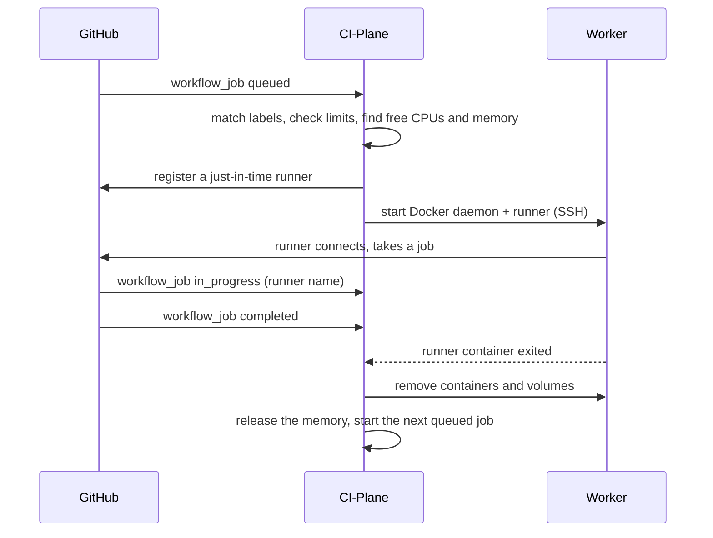

# 🧭 How it works

This page covers the architecture of CI-Plane, the life of a job, how a worker is chosen and what runs on a worker.

CI-Plane is one process with one SQLite file. It listens for jobs on GitHub, decides where each one runs, starts a
runner there over SSH and removes it when the job is over.


## 🚪 Two doors

| Listener | Reachable from | Serves | Login |
|---|---|---|---|
| `:8080` | your local network | interface, API, first-run password, `/healthz` | admin password |
| `127.0.0.1:8081` | `cloudflared` inside the container only | `/webhook`: signed GitHub events. Everything else: interface and API | Cloudflare Access |

Because the tunnel has its own listener, CI-Plane always knows whether a request came from outside. Outside requests
need a valid Cloudflare Access token, which CI-Plane verifies itself; `/webhook` needs GitHub's signature. The first
password can only be set on the local listener. More in [Security](security.md#-the-two-listeners).

## 🔁 Life of a job



1. **Queued.** A job is handled when its `runs-on` contains `ci-plane` and every other label is known
   (`self-hosted`, `linux`, `x64`, at most one size). A job with the `ci-plane` label that does not fit, or whose
   repository or account is switched off, is shown as *ignored* with the reason. Jobs for other runners are not
   stored at all.
2. **Placed.** The scheduler picks a worker ([below](#-choosing-a-worker)) and stores a runner for the job. Only this
   intent is written; nothing has happened on the worker yet.
3. **Started.** CI-Plane registers a just-in-time runner on GitHub (valid for one job) and starts two containers on
   the worker: a Docker daemon of its own and the runner.
4. **Running.** GitHub reports which runner took the job.
5. **Removed.** When the job is over, both containers and their volumes are deleted, and so is the registration on
   GitHub. Everything the job pulled, built or started lived inside its own Docker daemon, so nothing is left on the
   worker.

The end of a job is noticed three ways: the `completed` webhook, the runner container exiting, and the comparison
with GitHub. Any one of them is enough.

### Runners are not tied to jobs

GitHub gives a queued job to **any** idle runner that has all of the job's labels. CI-Plane starts one runner per
waiting job and designates it for that job, but GitHub may pair them differently. So CI-Plane tracks jobs and
runners separately and corrects the pairing when GitHub says who took what:

- A runner carries its size as a label, so a job that asks for `size-l` only ever lands on a large runner. A job
  without a size label may land on a runner of any size, which is why naming the size is a good habit.
- If another job takes a runner, the job it was meant for takes over that job's runner, or gets a new one.
- A runner nobody waits for is given to the next fitting job, or removed after a minute (at once when a job waits
  for room).

### States

| | States |
|---|---|
| Job | `queued` → `assigned` → `running` → `completed`, or `ignored` |
| Runner | `provisioning` → `starting` → `idle` → `busy` → `cleaning` → `removed` |
| Worker | `setup` → `online`; `unreachable`, `unhealthy`, `disk-full`; plus the switches *on/off* and *draining* |

Names are deterministic: `ci-plane-<installation>-<worker>-<id>`, where `<installation>` is six hex characters
chosen when the database was created. Every Docker object of a runner carries the label `ci-plane.runner=<name>`.
After a crash CI-Plane finds what it started by name and label, and finishes or undoes it.

## 🎯 Choosing a worker

**Sizes.** A size, chosen with a label, says what a job needs to start: free CPUs and memory.

| Label | Free CPUs to start | Memory | |
|---|---|---|---|
| `size-s` | 2 | 4 GB | |
| `size-m` | 4 | 8 GB | used when no size is given |
| `size-l` | 8 | 16 GB | |
| `size-xl` | 16 | 32 GB | |

The two are handled differently, because they fail differently. A job that gets too little CPU is slower; a job that
gets too little memory is killed.

- **CPU is measured, never limited.** A job starts on a worker that has the CPUs of its size free *right now*, and
  may then use every CPU nothing else wants. Free is what the server really has idle, whatever keeps it busy: jobs of
  CI-Plane or anything else that runs there.
- **Memory is reserved and limited.** The memory of the size is set aside on the worker for as long as the runner
  exists, and it is the limit of its containers.

**Free CPUs.** Every five seconds a worker reports its CPU use. CI-Plane counts as busy the higher of that value and
its average over about a minute, so a server that only pauses between two steps does not look free. A worker offers
its CPUs and memory minus a reserve for the system: 10 % of both, and 1 GB of memory on top, by default.

```
free CPUs = CPUs × 90 % − busy CPUs − CPUs held for new runners
```

A runner that has just started causes no load yet. So that ten jobs arriving in the same second do not all land on
the same idle worker, a runner **holds** the CPUs of its size from the moment it is placed until its job begins. Then it lets go of them
evenly over two minutes (*A new runner holds its CPUs for* in the settings), while its real load builds up and shows
in the measurement. After that only its real load counts: a `size-l` job
that uses one CPU leaves the other seven to the next job.

**Eligible** is a worker that is switched on, online (connected, healthy, enough free disk) and not draining, that
has the free CPUs of the size, whose unreserved memory holds the size, and whose memory available right now is at
least half the size's memory.

**Order.** The lowest **tier** with room wins; inside a tier, the worker with the largest free share
(the smaller of the free CPU share and the unreserved memory share), which is the least busy one. Tiers let you fill
your own hardware first and use an expensive machine only as overflow. After a failed start, the job tries another
worker first.

**Priority.** Each worker has a CPU priority for its runners: *normal*, *low* or *background*. It decides who gets
the CPU when a server is busy, and makes it safe to add a server that mainly does other work.
[Workers](workers.md#-cpu-priority) has the details.

**Failover.** If you switched it on, a job that found no room for a few minutes goes to a runner on a GitHub-hosted
machine instead ([Failover to GitHub](failover.md)).

**Queue.** If no worker has the CPUs and memory free, the job waits, oldest first, within the limits of parallel jobs per repository and per
account. A small job may overtake a large one that does not fit yet. After five minutes of waiting, nothing overtakes
a job on a worker that could hold it once the runners there are done. A worker that is busy with other work only is
not kept free: that load may never end.

## 🧱 On the worker

CI-Plane needs Docker and an SSH login on a worker, nothing else. It never installs an agent. All actions are plain
`docker` commands sent over one SSH connection per worker; a long-running command on the same connection streams
load, available memory and free disk every five seconds.

| Per job | |
|---|---|
| `<name>-dind` | `docker:dind`, privileged, limited to the memory of the size: the Docker daemon of this job only |
| `<name>-runner` | the runner image, unprivileged, sharing the network of its daemon (service ports answer on `localhost`) |
| `<name>-net` | the network of the job; the registry mirror joins it |
| `<name>-docker`, `-work`, `-run` | Docker data, the work directory and the daemon's socket, deleted with the job |

| Per worker, kept between jobs | |
|---|---|
| runner, `docker:dind` and `registry:2` images | pulled in advance and refreshed daily, so a runner starts in seconds |
| `ci-plane-externals-<image>` | a read-only copy of the runner's tools, shared by all jobs, which container jobs need |
| `ci-plane-mirror` | a pull-through cache for Docker Hub, emptied when it grows past its cap |
| `ciplane.slice` | only with a CPU priority other than *normal*: the cgroup of the runners, which carries the priority |

CI-Plane only creates and removes Docker objects named `ci-plane-*` that carry a `ci-plane.*` label. Whatever else
runs on the server is left alone.

## 📐 Design decisions

- **Registry mirror for Docker Hub only.** Docker's mirror setting does not apply to other registries such as GHCR.
  Docker Hub is where rate limits and repeated pulls hurt; other registries are pulled directly.
- **One GitHub App per account or organisation.** A private app can only be installed on the account that owns it,
  and a public app could be installed by strangers. See [GitHub](github.md#-the-github-app).
- **No CPU limit.** A limit would leave CPUs idle while jobs wait, and would still not protect the other work of a
  server from a job that uses its full limit. Placing by measured load and a priority per worker do both.
- **Memory limit per container, not per job.** A job is two containers, and each gets the memory of the size as its
  limit. See [Security](security.md#-resource-limits).
- **A slow check stays.** Webhooks are the fast path; once a minute CI-Plane compares its state with GitHub, and
  every five minutes it asks GitHub to redeliver failed webhooks. This is a safety net, not a way to run without
  the tunnel.

## 🛟 What keeps it running

Every pass of the engine compares what is with what should be and takes the next step. Steps can be repeated and
are stored before they are carried out, so a crash at any point is continued, not repaired by hand.
[Reliability](reliability.md) lists each failure and what happens.
