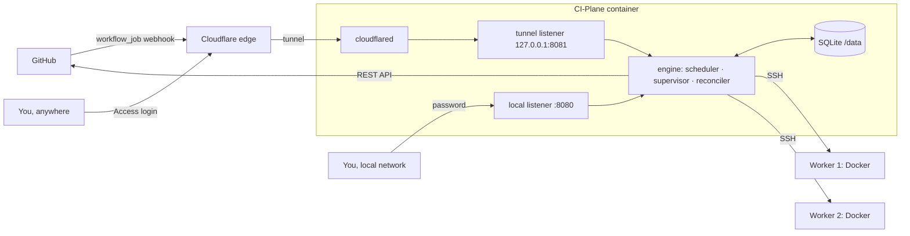
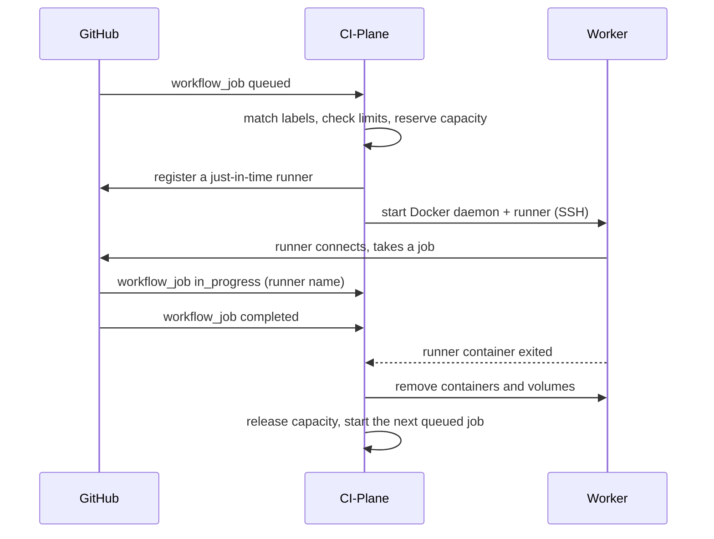

# 🧭 How it works

CI-Plane is one process with one SQLite file. It listens for jobs on GitHub, decides where each one runs, starts a
runner there over SSH and removes it when the job is over.

## 🚪 Two doors

| Listener | Reachable from | Serves | Login |
|---|---|---|---|
| `:8080` | your local network | interface, API, first-run setup | admin password |
| `127.0.0.1:8081` | `cloudflared` inside the container only | `/webhook`: signed GitHub events. Everything else: interface and API | Cloudflare Access |

Because the tunnel has its own listener, CI-Plane always knows whether a request came from outside. Outside
requests need a valid Cloudflare Access token, which CI-Plane verifies itself; `/webhook` needs GitHub's signature.

## 🔁 Life of a job

1. **Queued.** A job is handled when its `runs-on` contains `ci-plane` and every other label is known
   (`self-hosted`, `linux`, `x64`, one size). Anything else with the `ci-plane` label is shown as *ignored* with the
   reason; jobs for other runners are not stored at all.
2. **Placed.** The scheduler picks a worker ([below](#-choosing-a-worker)) and stores a runner for the job. Only this
   intent is written; nothing has happened on the worker yet.
3. **Started.** CI-Plane registers a just-in-time runner on GitHub (valid for one job) and starts two containers on
   the worker: a Docker daemon of its own and the runner.
4. **Running.** GitHub reports which runner took the job.
5. **Removed.** When the job is over, both containers and their volumes are deleted. Everything the job pulled,
   built or started lived inside its own Docker daemon, so nothing is left on the worker.

### Runners are not tied to jobs

GitHub gives a queued job to **any** idle runner that has all of the job's labels. CI-Plane starts one runner per
waiting job and designates it for that job, but GitHub may pair them differently. So CI-Plane tracks jobs and
runners separately and corrects the pairing when GitHub says who took what:

- A runner carries its size as a label, so a job that asks for `size-l` only ever lands on a large runner.
- If another job takes a runner, the job it was meant for takes over that job's runner, or gets a new one.
- A runner nobody waits for is reused by the next fitting job, or removed after a minute.

### States

| | States |
|---|---|
| Job | `queued` → `assigned` → `running` → `completed`, or `ignored` |
| Runner | `provisioning` → `starting` → `idle` → `busy` → `cleaning` → `removed` |
| Worker | `setup` → `online`; `unreachable`, `unhealthy`, `disk-full`; plus the switches *enabled* and *draining* |

## ⚖️ Choosing a worker

**Sizes.** A job reserves a fixed amount of CPU and memory, chosen with a label. The reservation is also the limit
of its containers.

| Label | CPU | Memory | |
|---|---|---|---|
| `size-s` | 2 | 4 GB | |
| `size-m` | 4 | 8 GB | used when no size is given |
| `size-l` | 8 | 16 GB | |
| `size-xl` | 16 | 32 GB | |

**Capacity.** A worker offers what it has minus a reserve for the system (10 % and 1 GB by default). Free capacity is
that minus the reservations of the runners on it. Reservations make the decision exact even when ten jobs arrive in
the same second, before any of them causes load.

**Eligible** is a worker that is enabled, online, not draining, has room for the size, has enough free disk, and
whose memory is not being eaten by something CI-Plane does not know about (measured every five seconds).

**Order.** The lowest **tier** with room wins; inside a tier, the worker with the largest free share. Tiers let you
fill your own hardware first and use an expensive machine only as overflow.

**Queue.** If nothing fits, the job waits, oldest first, within the limits per repository and account. A small job
may overtake a large one that does not fit yet. After five minutes of waiting, nothing overtakes a job on a worker
that could hold it.

## 🧱 On the worker

CI-Plane needs Docker and an SSH login on a worker, nothing else. It never installs an agent.

| Per job | |
|---|---|
| `ci-plane-<worker>-<id>-dind` | a Docker daemon for this job only, privileged, limited to the size |
| `ci-plane-<worker>-<id>-runner` | the GitHub runner, unprivileged, sharing the network of its daemon |
| volumes | work directory and Docker data, deleted with the job |

| Per worker, kept between jobs | |
|---|---|
| runner image | pulled in advance and refreshed daily, so a runner starts in seconds |
| `ci-plane-mirror` | a pull-through cache for Docker Hub with a size cap |

CI-Plane only creates and removes Docker objects named `ci-plane-*`. Whatever else runs on the server is left alone.

## 🛟 What keeps it running

Every pass of the engine compares what is with what should be and takes the next step. Steps can be repeated and
are stored before they are carried out, so a crash at any point is continued, not repaired by hand.
[Reliability](reliability.md) lists each failure and what happens.
