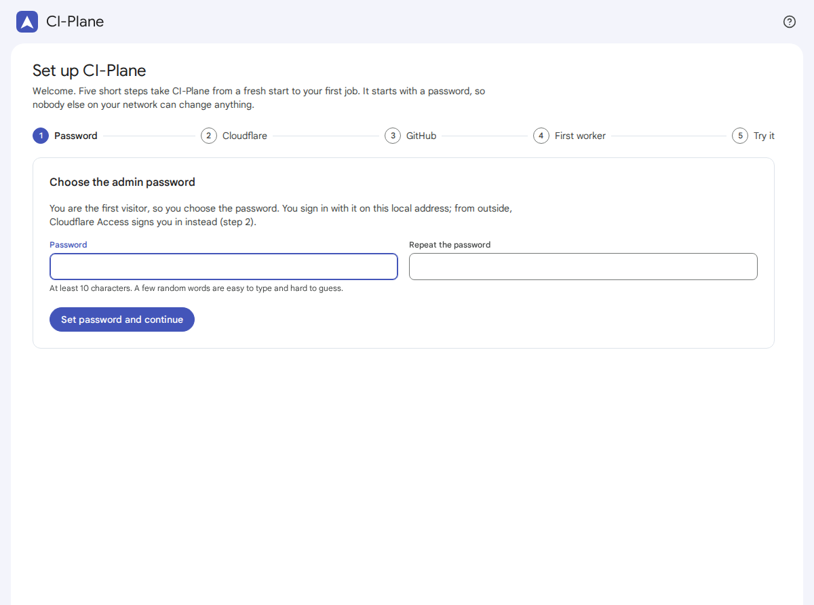
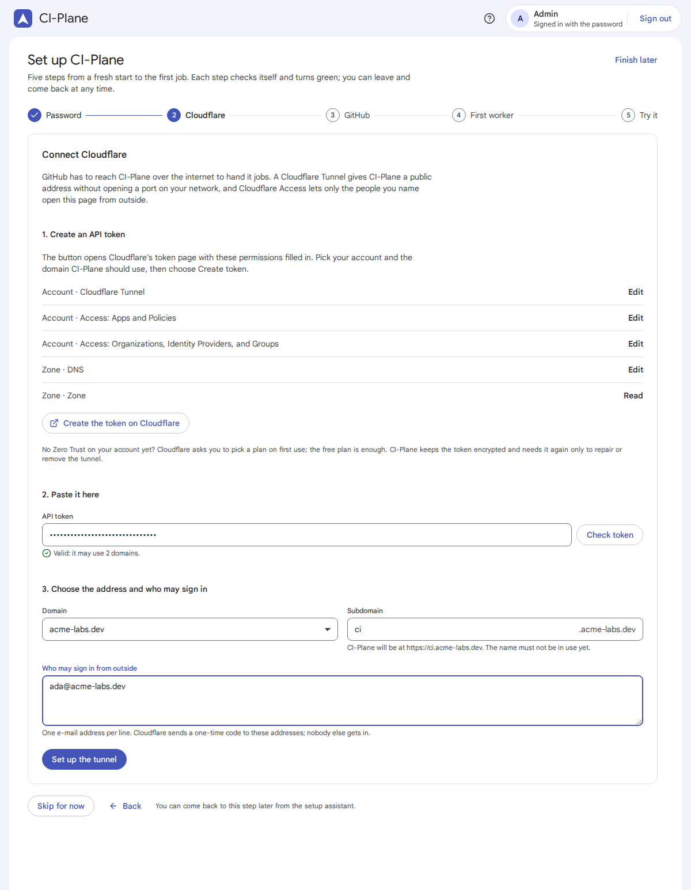
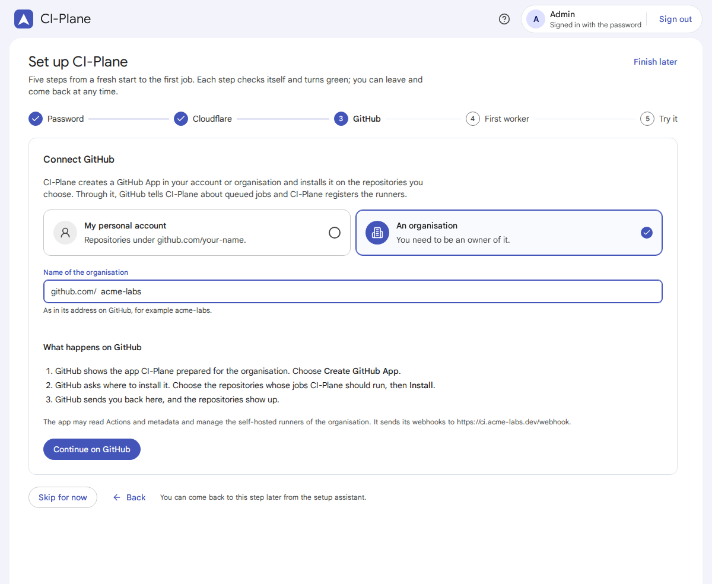
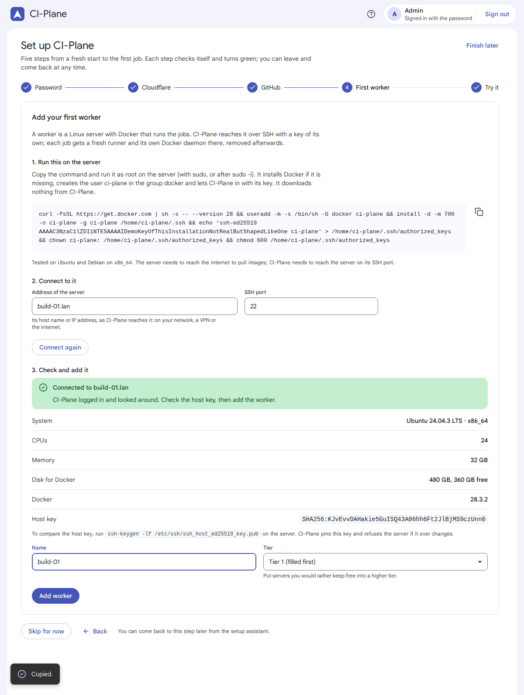
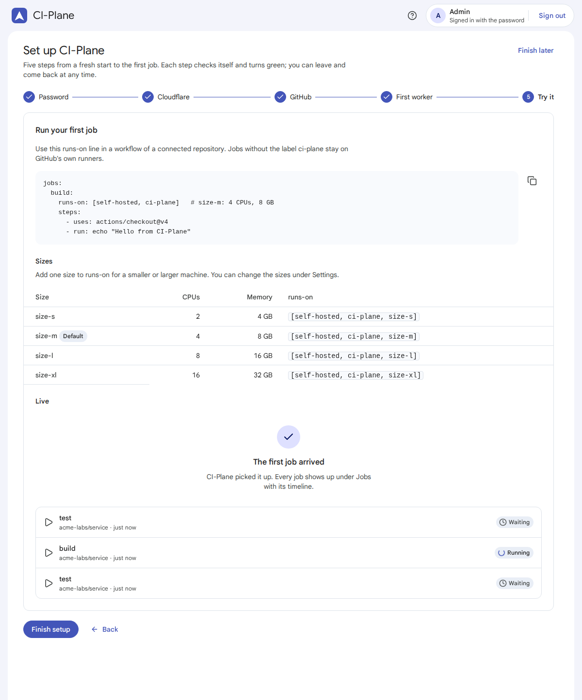

# ⚡ Quick start

This page takes you from `docker run` to the first green job, click by click.

You need: a Linux machine with Docker for CI-Plane, a Linux server for the jobs (it can be the same machine), a domain
on Cloudflare, and a GitHub account or an organisation you own. Plan for about ten minutes.

## 🐳 1. Start CI-Plane

```sh
docker run -d --name ci-plane --restart unless-stopped \
  -p 8080:8080 -v ci-plane:/data ghcr.io/saschazesiger/ci-plane:latest
```

Or with Compose: copy [docker-compose.yml](../docker-compose.yml) and run `docker compose up -d`.

The image is `linux/amd64`. All state goes into the volume `ci-plane` (mounted at `/data`). The log tells you where to
go next:

```sh
docker logs ci-plane
```

> ⚠️ **Open the interface right away.** There is no setup code: whoever opens the local address first chooses the
> admin password. Both commands above publish port 8080 on every interface of the machine; keep it off the internet.

## 🌐 2. Open the interface

Open `http://<address of the machine>:8080`, for example `http://192.168.1.10:8080` or `http://ci-box.lan:8080`.

IP addresses, single names (`ci-box`) and names ending in `.lan`, `.local`, `.home`, `.internal` and a few more work
out of the box. A name like `ci.example.com` is refused until you list it in `CI_PLANE_HOSTS`
([Configuration](configuration.md#-environment-variables)).

## 🔐 3. Step 1: password



Choose a password of at least 10 characters, repeat it, and choose **Set password and continue**. You are signed in.
On the local address you always sign in with this password; from the internet, Cloudflare Access signs you in
instead (next step).

## ☁️ 4. Step 2: Cloudflare



GitHub has to reach CI-Plane to deliver jobs. A Cloudflare Tunnel does that without opening a port.

1. **Create the token.** Choose **Create the token on Cloudflare**. Cloudflare's token page opens with the five
   permissions filled in. Pick your account and the domain under *Zone Resources*, then **Create token** and copy it.
   If a permission is missing from the form, add it by hand; the list is on the page and in
   [Cloudflare](cloudflare.md#-the-api-token).
2. **Paste it** and choose **Check token**. CI-Plane lists the domains the token may use.
3. **Choose the address and who may sign in.** Pick the domain, keep or change the subdomain (`ci` gives
   `https://ci.<your domain>`), and enter the e-mail addresses that may open CI-Plane from the internet, one per line.
4. Choose **Set up the tunnel**. CI-Plane creates the tunnel, the DNS record and two Cloudflare Access applications,
   starts `cloudflared` and checks from outside that the address asks for a login and that `/webhook` answers. This
   takes about a minute; you may leave the page meanwhile.

If Zero Trust was never enabled on the account, the step says so: open <https://one.dash.cloudflare.com/> once, choose
a team name and the free plan, then choose **Set up the tunnel** again (the error text calls this "Try again").

When the step shows **The tunnel is up**, choose **Next: GitHub**.

## 🐙 5. Step 3: GitHub



1. Choose **My personal account** or **An organisation** (you must be an owner; enter its name as in its address).
2. Choose **Continue on GitHub**. GitHub shows the app CI-Plane prepared. Choose **Create GitHub App**.
3. GitHub asks where to install it. Choose the repositories whose jobs CI-Plane should run, then **Install**.
4. GitHub sends you back; the step lists the connected repositories.

Each account or organisation gets an app of its own; add more later under **Repositories**. What the app may do:
[GitHub](github.md#-the-github-app).

## 🖥️ 6. Step 4: first worker



1. **Copy the setup command** and run it as root on the server (`sudo -i` first, or prefix it with `sudo`). It
   installs Docker if it is missing, creates the user `ci-plane` in the group `docker` and authorises CI-Plane's key.
   It downloads nothing from CI-Plane. [Workers](workers.md#-the-setup-command) lists every line.
2. **Enter the address** (host name or IP, as CI-Plane reaches it) and the SSH port, and choose **Connect**. If the
   command has not run yet, CI-Plane keeps trying every 5 seconds.
3. **Check and add.** CI-Plane shows the system, CPUs, memory, disk and the SSH host key. Compare the key with
   `ssh-keygen -lf /etc/ssh/ssh_host_ed25519_key.pub` on the server, give the worker a name and a tier, and choose
   **Add worker**.
4. CI-Plane prepares the worker: pulls the runner, Docker-in-Docker and registry images, starts the registry mirror
   and runs a test container. This takes a minute or two. The step turns green with **… is ready**.

> The demo in the screenshots shows a shortened stand-in for the setup command. Yours is longer and starts with
> `sh -c '`.

## 🚀 7. Step 5: try it



Add a workflow to a connected repository, for example `.github/workflows/ci-plane.yml`:

```yaml
name: CI-Plane test
on: [push, workflow_dispatch]

jobs:
  hello:
    runs-on: [self-hosted, ci-plane, size-s]
    steps:
      - uses: actions/checkout@v5
      - run: echo "Hello from $(hostname)"
      - run: docker run --rm hello-world
```

Push it. Within seconds the job shows up under **Live**, then under **Jobs** with its timeline. On GitHub it runs on
a runner named `ci-plane-…` and turns green. Choose **Finish setup**.

## ✅ Next

- Add more servers under **Workers**, put the ones you would rather keep free into tier 2: [Workers](workers.md).
- Adjust sizes and timeouts under **Settings**: [Configuration](configuration.md).
- Read [Security](security.md) before connecting more repositories.
- Something is stuck? [Troubleshooting](troubleshooting.md).
